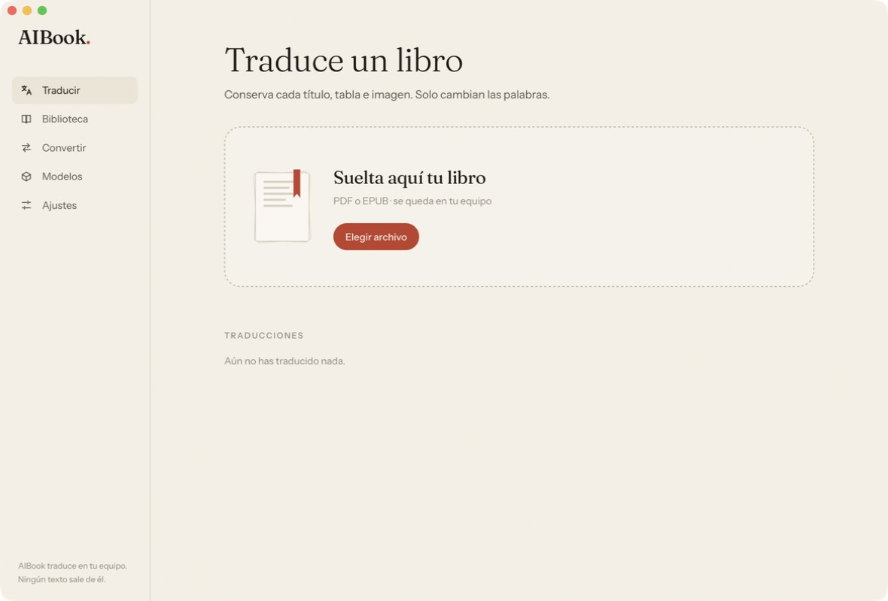

# AIBook.

### Tus libros, en tu idioma. Sin que salgan de tu equipo.

Traduce novelas y libros técnicos en **PDF y EPUB** con inteligencia artificial que funciona en tu propio ordenador.
Sin suscripciones, sin subir nada a la nube, sin perder una sola página de formato.

[**Descargar AIBook**](https://github.com/sorodriguezz/AIBook/releases/latest) · macOS (Apple Silicon) · Windows · Windows ARM

 

 

## Suelta tu libro. Lo demás corre por cuenta de AIBook.

Arrastra un PDF o un EPUB, elige el idioma y pulsa **Traducir**. AIBook lee el libro entero antes de empezar, aprende quién es quién y te devuelve un libro que se ve igual que el original: mismos capítulos, mismas tablas, mismas imágenes. Solo cambian las palabras.

## Por qué AIBook

**🔒 Privado de verdad**
Todo ocurre en tu equipo. Ni el libro ni una sola frase de la traducción salen de él. Funciona incluso sin internet, una vez descargado el modelo.

**📖 Traduce como un editor, no como un diccionario**
Antes de traducir, AIBook conoce a los personajes, cómo habla cada uno, los lugares y los términos inventados del libro. Mantiene la voz de cada personaje, traduce los modismos por su sentido y respeta las convenciones de cada idioma, como los diálogos con raya en español o las comillas « » en francés.

**🎨 El libro se ve como el original**
Títulos, índices, tablas, notas, imágenes y tipografía se quedan donde estaban. Funciona también con **PDF escaneados**: reconoce el texto de la imagen y lo reescribe sobre la página.

**🧠 Novela o manual técnico**
AIBook reconoce el tipo de libro. En las novelas cuida el estilo y la voz; en los libros técnicos deja intactos el código y los comandos, y mantiene la terminología del sector.

**✍️ Tú tienes la última palabra**
Revisa el glosario de personajes y términos antes de empezar, compara el original con la traducción párrafo a párrafo y corrige lo que quieras. ¿Lees una saga? El glosario se comparte entre los libros de la serie, así los nombres no cambian de un tomo a otro.

**⏱️ Sabes cuánto falta**
Una cuenta atrás realista que aprende de tu equipo, avisos al terminar y una cola para dejar varios libros traduciéndose mientras haces otra cosa. Si cierras la app, la traducción sigue donde la dejaste.

## 7 idiomas, en todas las direcciones

🇪🇸 Español · 🇬🇧 Inglés · 🇫🇷 Francés · 🇩🇪 Alemán · 🇮🇹 Italiano · 🇯🇵 Japonés · 🇨🇳 Chino

Cualquier combinación, por ejemplo de japonés a español o de alemán a inglés.

## El modelo justo para tu equipo

AIBook revisa tu memoria y tu tarjeta gráfica, y te dice qué modelos van **óptimos**, cuáles **funcionan** y cuáles **no caben**. Los descargas desde la propia app con un clic. Con **Medir en mi equipo** sabrás cuánto tardaría un libro de 300 páginas antes de empezar.

## Y además

- **Convierte entre EPUB y PDF**: pasa tus EPUB a PDF, o tus PDF a un EPUB que se adapta a cualquier pantalla.
- **Biblioteca**: todos tus libros y traducciones en un solo lugar, con sus portadas.
- **Se actualiza sola**: cuando hay una versión nueva, AIBook te avisa y la instala sin interrumpir lo que estés traduciendo.

## Instalación

1. Descarga el instalador para tu sistema desde la [**última versión**](https://github.com/sorodriguezz/AIBook/releases/latest).
2. Ábrelo y, en **Modelos**, descarga el que AIBook te recomiende.
3. Suelta tu primer libro. 📚

> **Primera vez en macOS:** si el sistema dice que no puede verificar la app, ve a *Ajustes del Sistema → Privacidad y seguridad* y pulsa **Abrir igualmente**.
>
> **En Windows:** si aparece SmartScreen, pulsa *Más información → Ejecutar de todas formas*.

### Requisitos

- macOS con chip Apple (M1 o posterior), Windows 10/11 de 64 bits o Windows en ARM.
- Recomendado: 16 GB de RAM o más. Con 8 GB funciona usando modelos ligeros.

 

**AIBook** es software libre bajo licencia AGPL-3.0 · [Guía para desarrolladores](docs/DEVELOPMENT.md)

